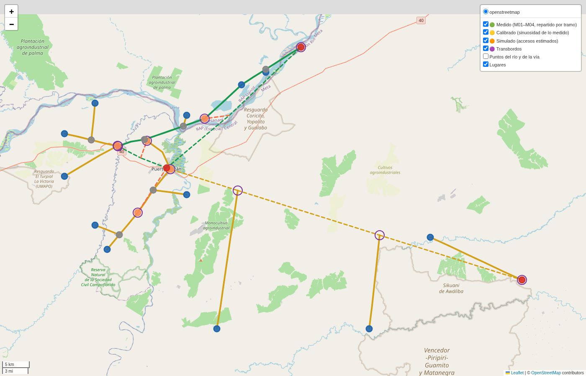
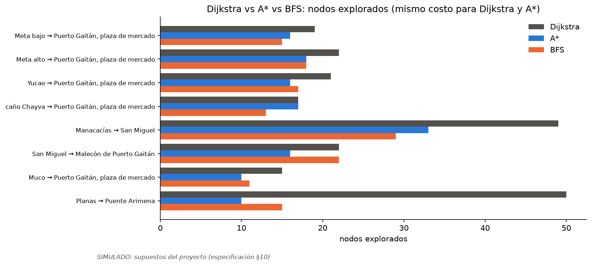
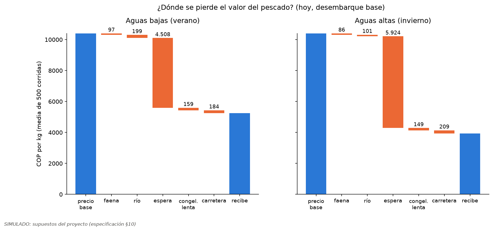
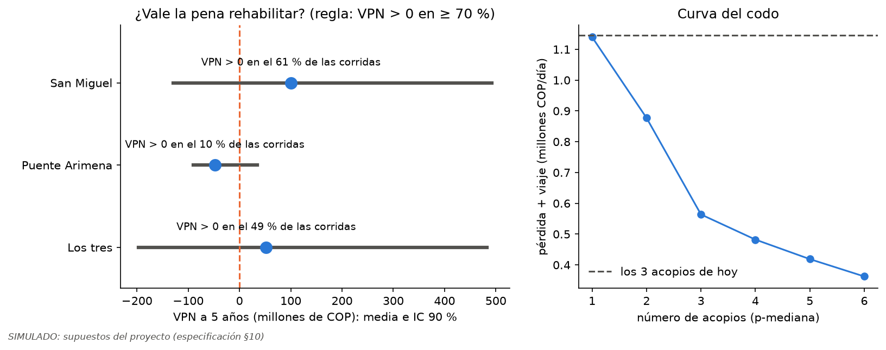
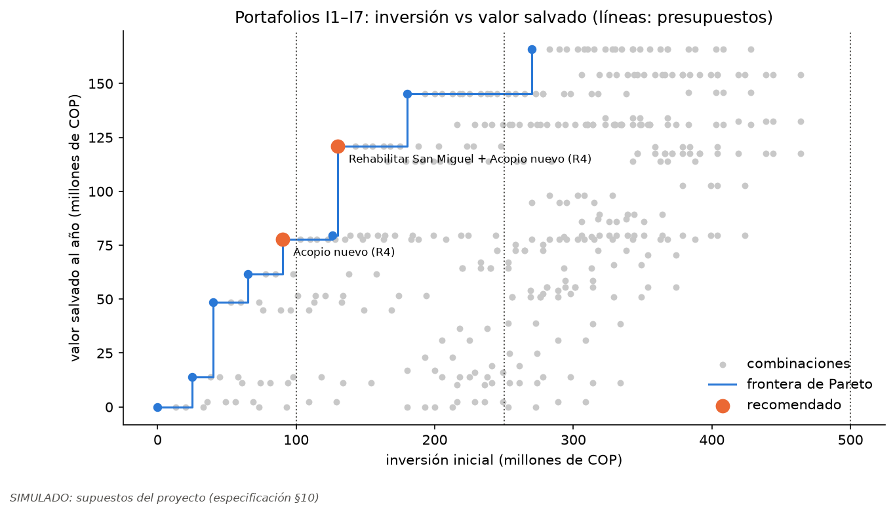
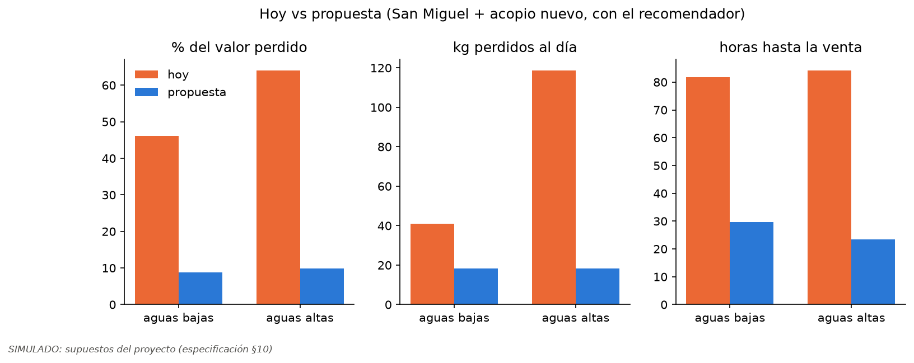

# Transporte y cadena de frío del pescado en Puerto Gaitán (Meta): diagnóstico y propuesta con grafos y optimización

**Proyecto universitario de ingeniería** · Noviembre de 2026 · Repositorio: <https://github.com/MiguelTenorio-Dev/pesca-puerto-gaitan> (release v1.0)

> **Cómo leer las cifras.** Los resultados salen de `outputs/resumen_resultados.md`, que genera el código
> (`python scripts/correr_todo.py`), y al lado de cada cifra se indica la sección de origen, por ejemplo *(resumen, R2)*.
> Los supuestos salen de la tabla §10 de la especificación (`docs/ESPECIFICACION.md`) y se citan como *(especificación §10)*.
> Las cifras marcadas **SIMULADO** son supuestos del proyecto, no mediciones. Las conclusiones que dependen de ellas
> se reportan con Monte Carlo, como media e intervalo del 90 %.

---

## Resumen

El pescado de Puerto Gaitán pierde gran parte de su valor entre la captura y la venta. Construimos una red multimodal
río + carretera calibrada con rutas medidas en Google Earth. Sobre ella simulamos la cadena actual, pescador por
pescador, con volúmenes calibrados al registro oficial del SEPEC.

**Diagnóstico.** La pérdida no viene del viaje por el río: viene de la **espera de 7 a 15 días** hasta que llega el
comprador. En el escenario base el pescador pierde el 49,6 % del valor en aguas bajas (90 %: 24,4 a 68,6) y el 62,3 %
en aguas altas (90 %: 41,7 a 78,3) *(resumen, R2)*. La espera pesa más que el río en el 100,0 % de las corridas, con
cualquiera de las cuatro ubicaciones posibles del desembarque informal *(resumen, R2)*.

**Solución evaluada.** Recomendador de rutas, reparto óptimo de la flota, viabilidad y reubicación de acopios, y 384
portafolios de inversión en frío.

**Propuesta final.** Rehabilitar San Miguel y abrir un acopio nuevo sobre el Meta (inversión de 130,0 M COP) *(resumen, R5)*.
En aguas bajas, el valor perdido de la flota de ejemplo pasa de 46,1 % a 8,7 % *(resumen, R6)*. Dos advertencias:
- cerca de dos tercios de esa mejora se logran solo con que los pescadores sigan el recomendador, sin invertir;
- el VPN de la inversión es positivo en el 52 % de las corridas, por debajo de la regla del 70 % *(resumen, R5 y R6)*.

---

## 1. El problema

En Puerto Gaitán el pescado se captura en el Meta, el Manacacías, el Yucao y en ríos de la cuenca del Vichada.
Los trayectos son largos, a veces van contra la corriente y no hay cadena de frío. Cuando el pescado llega a la plaza,
el comprador paga por su calidad, y esa calidad ya se perdió en el camino.

El proyecto se propuso tres cosas:
1. **diagnosticar** en qué etapa de la cadena se pierde el valor;
2. **proponer** con grafos y optimización a dónde debe llevar cada pescador su pescado, qué acopios convienen y qué inversiones en frío valen la pena;
3. **entregar** esa respuesta a los pescadores en una aplicación web y en una cartilla imprimible.

La métrica central es el valor que recibe el pescador: kg vendidos × precio base × factor de precio según la calidad
al momento de la venta (especificación §1 y §6).

## 2. La cadena de hoy

Según lo que contó el equipo (especificación §3.1), la cadena actual tiene estas etapas:
1. Faena en la zona de pesca.
2. Viaje por río en neveras de icopor deterioradas.
3. Entrega en un **desembarque informal**, donde una señora guarda el pescado en congeladores domésticos horizontales. Cuando se llenan, el resto va a icopor, y hay cortes de luz.
4. **Espera de 7 a 15 días** hasta que llega el comprador.
5. Carretera en carro hasta la plaza de Puerto Gaitán.

Existen tres acopios formales:
- **Puerto Gaitán:** la plaza, que funciona.
- **San Miguel:** tiene un cuarto frío de 4 m³ abandonado porque no se pudo pagar la luz.
- **Puente Arimena:** tiene un cuarto frío pequeño sin uso.

La ubicación exacta del desembarque informal no se conoce. Por eso se usan cuatro ubicaciones candidatas y se
reporta la sensibilidad a esa elección (especificación §3.4).

## 3. Datos

Cada dato lleva una etiqueta según su origen (especificación §4.1):

| etiqueta | qué es | ejemplos |
|---|---|---|
| MEDIDO | medido por el equipo en Google Earth | rutas M01–M04; coordenadas de San Miguel y del malecón (KML) |
| OFICIAL | fuentes públicas | desembarcos SEPEC/AUNAP 2022: 24,2 t en el malecón y 5,5 t en San Miguel; precios SIPSA en Villavicencio: 11 833 COP/kg de cachama y 14 000 COP/kg de bagre rayado (especificación §4.7 y §10) |
| CALIBRADO | ajustado para reproducir lo medido u oficial | sinuosidad de ríos y vías; volúmenes = SEPEC × `factor_subregistro` |
| SIMULADO | supuestos del proyecto (especificación §10) | velocidades, temperaturas, congeladores, costos de inversión |

**Distancias medidas** (especificación §4.2):

| ruta | modo | km |
|---|---|---|
| M01 | Yucao → Puerto Gaitán por carretera | 15,14 |
| M02 | Yucao → Puerto Gaitán por río | 17,38 |
| M03 | San Miguel → Puerto Gaitán por carretera | 38,9 |
| M04 | San Miguel → Puerto Gaitán por río, **todo contra la corriente** | 41,65 |

**Prioridad de los datos.**
- Para distancias: KML medido > distancias medidas > calibrado > simulado.
- Para volúmenes y precios: oficial > dato del equipo > simulado calibrado.

**Población de pescadores.** Es sintética. Reproduce el volumen del SEPEC multiplicado por un factor de subregistro
de 2,0 (especificación §10), que representa los desembarques informales que el SEPEC no registra.

Ningún dato personal de pescadores ni del desembarque informal está en el repositorio.

## 4. Modelo

### 4.1 Grafo multimodal dirigido

**Capas.** Cada lugar tiene un nodo en la capa de río y otro en la de carretera. Las aristas son de tres tipos:
- **río:** una por sentido, aguas arriba y aguas abajo;
- **carretera;**
- **transbordo:** une las dos capas en acopios y desembarques.

**Velocidades.** La velocidad en el río es la de la embarcación más o menos la corriente. La corriente es de 4 km/h
en aguas altas y 2 km/h en aguas bajas (especificación §10). Las embarcaciones van a 4 km/h (madera a remo), 15 km/h
(madera con motor), 5 km/h (aluminio a remo) y 28 km/h (aluminio con motor) en agua quieta (especificación §5).
Si la velocidad efectiva no supera el mínimo, el tramo es **infactible** para esa embarcación.

**Cuencas.** Hay dos cuencas sin conexión por agua: la del Meta y la del Vichada. Entre ellas solo se pasa por carretera.

**Calibración.** El grafo tiene 69 nodos y 148 aristas, y reproduce M01–M04 con error 0,000 % *(resumen, R1)*:
- los tramos exclusivos de cada ruta medida se escalan para reproducirla;
- los demás tramos usan la sinuosidad calibrada: 1,11 en río y 1,27 en carretera *(resumen, R1)*.

Ningún factor de calibración es menor que 1, de modo que cada arista mide al menos la línea recta entre sus extremos.
Esa es la condición que hace admisible la heurística de A\*.



### 4.2 Degradación

La calidad del pescado se modela con la tasa relativa de deterioro de Ratkowsky (especificación §6):

```
RRS(T) = (1 + 0,1·T)²   si T ≥ −10 °C;   RRS(T) = 0   si T < −10 °C
Q      = 1 − Σ_etapas  Δt · RRS(T) / VU₀
```

La vida útil en hielo es VU₀ = 360 h (especificación §10).

**Estados de conservación:**
- **ambiente** (32 °C);
- **icopor con hielo** (4 °C mientras dura el hielo);
- **congelado** (RRS = 0, con un castigo de precio por congelación lenta);
- **falla del congelador** por cortes de luz.

**Precio según calidad.** Es escalonado: factor 1,00 si Q ≥ 0,75; 0,70 entre 0,50 y 0,75; 0,40 entre 0,25 y 0,50;
y rechazo por debajo de 0,25 (especificación §6).

**Limitación.** El modelo de Ratkowsky se calibró sobre todo con especies de aguas templadas. Aquí se usa como aproximación.

## 5. Algoritmos

### 5.1 Búsqueda de rutas: Dijkstra, A\* y BFS (implementaciones propias)

Los tres algoritmos se implementaron desde cero (`busqueda.py`), y las pruebas los validan contra `networkx`:
- el peso de cada arista es la pérdida de calidad;
- la heurística de A\* es la línea recta, dividida por la máxima velocidad efectiva y multiplicada por la menor tasa de deterioro posible;
- BFS minimiza el número de tramos.

En los ocho pares de prueba *(resumen, R1)*:
- **A\*** explora 136 nodos frente a 215 de Dijkstra (37 % menos), con el mismo costo en todos los casos;
- **BFS** explora 140 nodos y su ruta queda en promedio 0,0 % peor que la óptima (máximo 0,2 %).

Que BFS acierte casi siempre muestra que la red fluvial es casi un árbol: entre dos puntos suele haber un solo camino
por agua. Lo que cambia entre rutas es el **sentido** de la corriente, no la topología.



### 5.2 Problema de transporte

El reparto óptimo de la flota entre las formas de vender (plaza por río, desembarque con espera y acopio con frío)
se resuelve como un flujo de costo mínimo (`networkx.min_cost_flow`). Tiene estas características:
- **costo por kg:** valor perdido + gasolina y tiempo del pescador, ida y vuelta;
- **capacidades:** plaza, cuartos fríos y congeladores;
- **nodo `sin_destino`:** garantiza que el problema siempre tenga solución.

Como el precio es escalonado, primero se calcula la mejor ruta para cada par y después se resuelve el transporte.

### 5.3 p-mediana

La ubicación de acopios se resuelve con una p-mediana en PuLP/CBC. Los candidatos son 30 puntos del río y los tres
acopios actuales. Se resuelve en dos modos: mover los tres, o mantenerlos y agregar *k*.

## 6. Diagnóstico de la situación actual

**Supuestos del Monte Carlo** (especificación §10 y registro de decisiones):
- 500 corridas por candidata y temporada;
- un ciclo del comprador en un mes típico fuera de veda;
- parámetros uniformes en sus rangos.

**Cifras del escenario base** (candidata D01a) *(resumen, R2)*:

| indicador | aguas bajas | aguas altas |
|---|---|---|
| calidad media (0–1) | 0,47 (90 %: 0,29 a 0,70) | 0,35 (90 %: 0,20 a 0,55) |
| % del valor perdido | 49,6 (90 %: 24,4 a 68,6) | 62,3 (90 %: 41,7 a 78,3) |
| COP perdidos al mes | 42,1 M (90 %: 13,9 M a 79,6 M) | 51,7 M (90 %: 24,1 M a 91,6 M) |
| COP/kg perdidos en el río | 199 (90 %: 10 a 844) | 101 (90 %: 14 a 374) |
| COP/kg perdidos en la espera | 4.508 (90 %: 1.981 a 7.377) | 5.924 (90 %: 3.625 a 8.657) |
| COP/kg que recibe el pescador | 5.249 (90 %: 2.989 a 8.338) | 3.927 (90 %: 2.025 a 6.694) |



**Hipótesis verificada: la espera pesa más que el río.**
- En aguas bajas, la espera destruye 4.508 COP/kg frente a 199 COP/kg en el río: una razón media de 124 veces *(resumen, R2)*.
- La espera pesa más en el 100,0 % de las corridas, en las dos temporadas.
- La ubicación del desembarque informal no cambia la conclusión: el valor perdido varía 1,2 puntos entre candidatas en aguas bajas y 6,2 en aguas altas *(resumen, R2)*.

**El río sí importa en un caso.** Cuando un bote a remo no puede remontar la corriente, el pescador vende río abajo,
donde alcanza, y eso decide **a dónde** va el pescado. Esto pasa sobre todo en aguas altas, con una corriente de 4 km/h
frente a los 4 km/h de un bote de madera a remo (especificación §10). Por eso el diagnóstico desemboca en una
respuesta de logística y de frío, no solo de velocidad.

## 7. Solución

### 7.1 Recomendador y reparto óptimo (R3)

El recomendador compara, para cada pescador, todas las formas de vender que tiene a su alcance:
- **plaza por río;**
- **desembarque con espera**, incluido el riesgo de que el pescado no quepa en el congelador;
- **acopio con frío** + transbordo + carretera.

Recomienda la que deja más **plata neta**: lo que le pagan menos la gasolina y el tiempo.

En la población de ejemplo, con los acopios de hoy, si cada pescador sigue el reparto óptimo la pérdida + viaje baja
de 2,1 M a 1,2 M COP/día, un 42 % menos, **sin invertir nada** *(resumen, R3)*. Quedan 30,9 kg/día de 245 sin destino
posible: son botes a remo de zonas lejanas *(resumen, R3)*.

### 7.2 Acopios (R4)

**Regla de decisión** (especificación §10): un acopio vale la pena si su VPN a 5 años, al 12 %, es positivo en al
menos el 70 % de las corridas. La energía se cobra aparte, porque fue la causa del abandono de San Miguel.

Resultados *(resumen, R4)*:
- **San Miguel:** VPN medio de 100,4 M (90 %: −129,3 M a 492,4 M), positivo en el 61 % de las corridas. No pasa la regla.
- **Puente Arimena:** −48,2 M, positivo en el 10 % de las corridas.
- **Los tres juntos:** positivo en el 49 % de las corridas.

**Reubicación.** Agregar un acopio en el punto `R_META_03` baja la pérdida + viaje de 1,1 M a 0,8 M COP/día *(resumen, R4)*.
Ese punto queda sobre el Meta, entre Yucao y la boca del Manacacías; su coordenada es aproximada.



### 7.3 Rutas bimodales, frío e inversión (R5)

**Las medidas I1–I7.** Cada una se modeló como un cambio del escenario:
- **I1** cajas térmicas;
- **I2** fábrica de hielo;
- **I3** rehabilitar San Miguel o Puente Arimena;
- **I4** acopio nuevo;
- **I5** camión refrigerado con ruta cada *N* días;
- **I6** subsidio de motor;
- **I7** mejorar el desembarque informal.

Se enumeraron 384 portafolios. La frontera de Pareto se construyó en inversión frente a valor salvado al año.

**Cada medida sola** (Monte Carlo de 100 corridas) *(resumen, R5)*:

| medida | valor salvado al año | VPN a 5 años | % VPN > 0 |
|---|---|---|---|
| Rehabilitar San Miguel | 69,2 M | 113,2 M | 61 % |
| Acopio nuevo (R4) | 57,8 M | 28,4 M | 45 % |
| Subsidio de motor | 18,3 M | 24,5 M | 54 % |
| Mejorar el desembarque de la señora | 14,9 M | 12,5 M | 33 % |
| Cajas térmicas + fábrica de hielo | 10,0 M | −165,2 M | 7 % |
| Camión refrigerado todos los días | 153,6 M | −630,7 M | 7 % |

Tres lecturas:
1. **El hielo casi no ayuda** (10,0 M al año). El pescado que va directo a la plaza ya llega con el mejor precio, y el que se daña lo hace por los días de espera, no por las horas de río. Es coherente con el diagnóstico.
2. **El camión refrigerado diario es lo que más valor salva** (153,6 M al año), porque elimina la espera. Pero recorrer el circuito todos los días cuesta más de lo que salva: su VPN es de −630,7 M.
3. **Las medidas que ganan son las de acopio.** El portafolio recomendado para 100 M es el acopio nuevo (inversión de 90,0 M). Para 250 M y para 500 M es San Miguel + acopio nuevo (inversión de 130,0 M, valor salvado de 111,5 M al año con 90 %: 8,4 M a 280,9 M, y VPN de 85,9 M) *(resumen, R5)*. Con 500 M no conviene gastar más.



## 8. Hoy vs propuesta

**Propuesta final.** San Miguel rehabilitado + acopio nuevo, con los pescadores siguiendo el recomendador.

Se comparó con hoy pescador por pescador, en la población de ejemplo *(resumen, R6)*:

| indicador | hoy, aguas bajas | propuesta, aguas bajas | hoy, aguas altas | propuesta, aguas altas |
|---|---|---|---|---|
| % del valor perdido | 46,1 | 8,7 | 63,9 | 9,8 |
| kg perdidos al día | 41,0 | 18,3 | 118,5 | 18,3 |
| calidad media (0–1) | 0,63 | 0,81 | 0,69 | 0,83 |
| horas hasta la venta | 81,7 | 29,7 | 84,1 | 23,4 |



**De dónde sale la mejora.** En aguas bajas, la plata neta de la flota pasa de $401.893 a $1.734.166 al día. De esa
mejora de $1.332.437/día *(resumen, R6)*:
- **$884.568/día** se logran solo con que los pescadores sigan el recomendador, sin invertir;
- **$447.869/día** los agrega la inversión.

**Riesgo.** El VPN de la inversión es positivo en el 52 % de las corridas *(resumen, R6)*. No alcanza la regla del 70 %.
La propuesta es razonable en el escenario medio, pero es una apuesta con riesgo, y su resultado depende sobre todo
de los costos de operación y de energía, que son supuestos.

Las cifras de hoy en esta sección no coinciden exactamente con las del diagnóstico, por una diferencia de método:
- **esta comparación** usa valores esperados del recomendador, la misma base de R3 a R5;
- **el diagnóstico** simula día a día un ciclo del comprador con su incertidumbre.

## 9. La aplicación

La aplicación web en Streamlit se instala con `pip install git+https://github.com/MiguelTenorio-Dev/pesca-puerto-gaitan`
y se abre con `pesca-gaitan`. Tiene nueve pantallas, en el orden de esta historia:
- diagnóstico;
- mapa de la red;
- laboratorio de algoritmos;
- **«¿A dónde llevo mi pescado?»**: el recomendador, donde el pescador hace clic en su ubicación y recibe la ruta, el sentido de la corriente, el transbordo y cuánta plata le queda;
- toda la flota;
- centros de acopio;
- bimodal y cadena de frío;
- hoy vs propuesta, con la **cartilla de rutas** en PDF y CSV para imprimir, porque en el río casi no hay señal;
- supuestos y datos.

Todo valor simulado aparece en pantalla con su etiqueta. Lo pesado (Monte Carlo, p-mediana, portafolios) está
precalculado, y cada página carga en pocos segundos.

## 10. Limitaciones

- **La mayor parte de los parámetros son simulados.** Velocidades, temperaturas, congeladores, costos de inversión y de operación, y número de pescadores (especificación §10). Por eso los resultados se dan con intervalos del 90 % y deben leerse como órdenes de magnitud y comparaciones, no como valores exactos.
- **La ubicación del desembarque informal no se conocerá.** Se usan cuatro candidatas. La conclusión principal no depende de cuál se use *(resumen, R2)*.
- **Coordenadas.** Solo San Miguel y el malecón están medidos en KML. La boca del Manacacías y las trazas de los ríos son aproximadas, y el tramo del Meta entre la boca y San Miguel quedó con factor de calibración 1,00, lo que sugiere que la boca estimada está demasiado al occidente.
- **Modelo de deterioro.** Viene de especies de aguas templadas.
- **El comprador no se modela como agente.** Su ciclo es aleatorio y no reacciona a la propuesta.
- **La propuesta no pasa la regla de decisión del 70 %.** Se recomienda como la mejor opción disponible, con ese riesgo explícito.

## 11. Trabajo futuro

- **Criaderos para la veda** (mayo a julio): piscicultura en jaulas como sustento en la veda. Quedó fuera de alcance (especificación §11).
- **App sin conexión:** una versión para celular que funcione sin señal en el río, con la cartilla integrada.
- **Medir lo que más mueve los resultados:** la boca del Manacacías, el consumo real de energía del cuarto frío de San Miguel, los tiempos reales de viaje que reporten los pescadores y el precio en la plaza según la calidad.
- **Modelar al comprador:** su ruta y su frecuencia, para evaluar si una ruta de recolección más barata que el camión diario hace rentable eliminar la espera.

---

## Anexo A. Supuestos

La tabla completa de supuestos, con valor, rango de Monte Carlo y etiqueta, está en la especificación §10. La app la
muestra en la pantalla «Supuestos y datos».

## Anexo B. Reproducibilidad

```bash
pip install -e ".[dev]"
python scripts/correr_todo.py        # Monte Carlo, p-mediana, portafolios, hoy vs propuesta y resumen
python scripts/figuras_informe.py    # figuras de este informe
python scripts/informe_pdf.py        # este informe en PDF
pytest -q                            # pruebas (incluye que cada cifra del informe esté en el resumen o en la especificación)
```

La semilla es fija (42), así que los resultados se reproducen exactamente.
